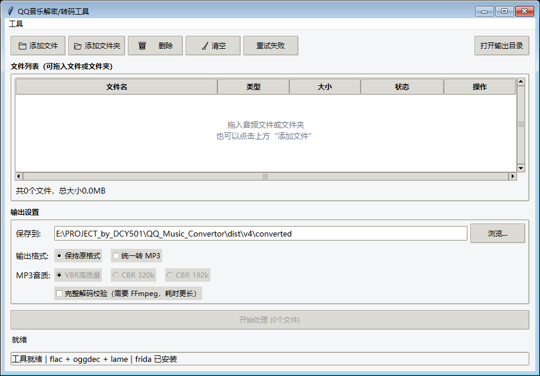

# QQ Music Converter

将 QQ 音乐客户端下载的本地文件转换为常见音频格式，也支持普通音频批量转 MP3。Windows 图形界面，拖入文件即可开始。

[](https://github.com/DCY501/QQmusic_converter/releases/latest)

[](LICENSE)

**[下载最新版](https://github.com/DCY501/QQmusic_converter/releases/latest)** · [快速上手](#快速上手) · [格式支持](#格式支持) · [常见问题](#常见问题) · [开发与打包](#开发与打包)



## 下载

前往 **[Releases](https://github.com/DCY501/QQmusic_converter/releases/latest)**，在 Assets 中选择：

| 文件 | 适合谁 | 使用方式 |
| --- | --- | --- |
| `QQMusicConverter-Windows-x64.zip` | 推荐，包含 FFmpeg，支持全部已实现功能 | 解压后运行 `QQMusicConverter.exe` |
| `qqmusic_converter_gui.exe` | 只需要基础转换，希望下载更小 | 直接运行；需要时另行添加 FFmpeg |
| `SHA256SUMS.txt` | 需要核对下载文件完整性 | 与本地文件的 SHA-256 对比 |

运行发布版不需要安装 Python。完整包中的 `ffmpeg.exe` 请与主程序放在同一目录；升级时先退出旧版，再解压到新文件夹。

> 加密文件需要先通过 QQ 音乐客户端下载，并在处理时运行兼容的客户端。当前解密接口支持 **32 位 QQ 音乐**，已实测文件版本 **22.5.0.0**；其他版本请先使用“工具 → 环境与兼容性诊断”检查。发布程序本身为 Windows 64 位程序。

## 快速上手

1. **添加文件**：拖入音频或文件夹，也可以点击“添加文件 / 添加文件夹”。
2. **选择输出**：设置保存目录，选择“保持原格式”或“统一转 MP3”。
3. **开始处理**：如需解密，先打开 QQ 音乐；普通音频无需运行客户端。
4. **查看结果**：点击列表中的“打开输出”。失败条目可查看原因，再点击“重试失败”。

需要换音质或格式时，选中文件，右键选择 **重新处理选中项**。右键 **文件详情** 可查看路径、时长、采样率、标签和校验结果。

## 功能

- **批量转换**：添加文件夹、拖拽导入、重复文件去重；单个文件失败后继续处理其余文件。
- **输出保护**：完成转换与校验后才保存结果。同名文件自动编号，不覆盖源文件和已有输出。
- **任务恢复**：记住列表与设置，重开后继续处理；恢复时检查源文件及输出是否发生变化。
- **音质与标签**：MP3 支持 VBR 高质量、CBR 320k、CBR 192k；尽量保留常用标签、歌词和内嵌封面。
- **进度与诊断**：显示当前文件、处理阶段和耗时；提供失败重试、错误日志及客户端兼容性检查。
- **输出校验**：默认检查格式、音频参数与时长；可选使用 FFmpeg 对输出执行完整解码校验。

“停止处理”会在 **当前文件完成并清理后停止**。关闭窗口也会等待当前文件完成；重新打开不会自动开始转换。重复启动新版会唤起已有窗口。

## 格式支持

| 输入格式 | 保持原格式 | 转 MP3 |
| --- | --- | --- |
| MFLAC / MFLAC0 | 解密为 FLAC | 支持 |
| MGG / MGG0 / MGG1 / MGGL | 解密为 OGG | 支持 |
| MMP4 | 解密为 MP4 | 需要 FFmpeg |
| FLAC / OGG / WAV | 原样复制 | 支持 |
| MP3 | 原样复制 | 原样复制，不重复编码 |
| M4A / MP4 | 原样复制 | 需要 FFmpeg |

MP4 / M4A 转 MP3 时只取第一条音轨，不输出视频，多声道会混合为立体声。标签迁移覆盖常用字段，并非所有自定义标签；标签处理失败时保留正常音频并单独提示。

## 常见问题

### 需要 VIP 吗？

本工具处理已经下载到本地的文件，不提供音乐下载，也不改变 QQ 音乐账号的下载权限。需要 VIP 才能下载的内容，仍需先满足客户端的下载条件。

### 为什么加密文件转换失败？

先确认 QQ 音乐已启动，再运行 **工具 → 环境与兼容性诊断**。客户端架构、版本接口、文件状态与权限都可能影响解密。接口检查通过仍需以实际文件处理结果为准。

### 什么时候需要 FFmpeg？

MMP4 / M4A / MP4 转 MP3、完整解码校验，以及 FLAC 备用解码需要 FFmpeg。完整 ZIP 包已包含；单 EXE 用户可从 [FFmpeg 下载页](https://ffmpeg.org/download.html)获取 Windows 构建，将 `ffmpeg.exe` 放到主程序同级目录。

### 基础校验和完整校验有什么区别？

基础校验检查输出格式、参数和时长，速度较快，但不能保证每个音频帧都没有损坏。完整解码校验会从头到尾解码输出，耗时更长；校验失败的临时文件不会提交为最终结果。

### 配置、任务记录和日志在哪里？

打开 **工具 → 打开配置目录**，即可找到本次运行实际使用的位置。

| 文件 | 内容 |
| --- | --- |
| `config.json` | 输出目录、格式、音质和校验设置 |
| `session.json` | 最近一次任务列表及状态 |
| `error.log` | 处理失败的详细记录 |

默认目录为 `%LOCALAPPDATA%\QQMusicConverter`。Windows 应用虚拟化可能将它重定向到另一磁盘，以菜单打开的位置为准。首次启动会尝试读取程序目录中的旧 `config.json`。

## 开发与打包

在 Windows 上使用 **Python 3.12** 验证。项目根目录中执行：

```powershell
# 创建环境并安装固定版本依赖
python -m venv .venv
.\.venv\Scripts\python.exe -m pip install -r requirements-dev.txt

# 从源码启动
.\.venv\Scripts\python.exe src\qqmusic_converter_gui.py

# 运行回归测试
.\.venv\Scripts\python.exe -m unittest discover -s tests -v

# 测试通过后打包
.\build.ps1
```

当前构建输出为 `dist\v5\QQMusicConverter.exe`；`v5` 是本地构建目录名，正式发布版本以 Release 标签为准。若根目录存在 `ffmpeg.exe`，构建脚本会将它复制到输出目录。

Hook 模拟测试需要 Node.js；部分音频集成测试需要 FFmpeg，缺少时会跳过相应测试。打包版本支持 `--self-check 报告路径.json`，进程退出后检查报告中的 `ok` 字段。

本版已通过 **52 项测试**及 EXE 自检。另已在 QQ 音乐 22.5.0.0（32 位）上实测 MGG、MFLAC、MMP4 及普通 FLAC / OGG 转 MP3，输出通过完整解码检查，源文件哈希未变；这不代表所有客户端版本及文件均兼容。

<details>
<summary>项目结构</summary>

```text
src/
├── gui.py                    界面与主线程事件队列
├── worker.py                 批处理、失败隔离与输出提交
├── decryptor.py              QQ 音乐连接与解密
├── hook_qqmusic_v17.js        客户端接口调用
├── converter.py              本地音频工具链
├── metadata.py               标签与封面迁移
├── audio_validation.py       基础校验与完整解码校验
├── scanner.py                文件扫描
├── models.py                 数据模型、配置与路径
├── session_store.py          任务保存与恢复
├── file_details.py           文件与音频详情
├── client_diagnostics.py     客户端兼容性诊断
├── single_instance.py         单实例与窗口唤起
├── diagnostics.py            打包自检
└── qqmusic_converter_gui.py   启动入口
tests/                        回归与集成测试
build.ps1                     测试与打包脚本
qqmusic_converter.spec        PyInstaller 资源清单
```

模块约定见 [源码说明](src/readme.md)。

</details>

## 致谢与许可

解密思路参考 [decrypt-mflac-frida](https://github.com/Noisrev/decrypt-mflac-frida)。感谢 [Frida](https://frida.re/)、[FLAC](https://xiph.org/flac/)、[Vorbis Tools](https://xiph.org/downloads/)、[LAME](https://lame.sourceforge.io/)、[FFmpeg](https://ffmpeg.org/)、[TkinterDnD2](https://github.com/Eliav2/tkinterdnd2) 和 [Mutagen](https://mutagen.readthedocs.io/)。

项目用于个人学习与本地文件处理。项目自身代码使用 [MIT License](LICENSE)，第三方组件遵循各自许可，详见 [第三方说明](THIRD_PARTY_NOTICES.md)。
